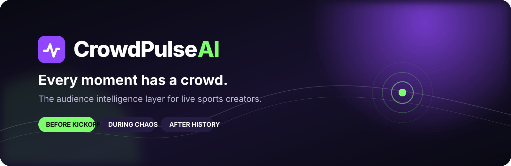
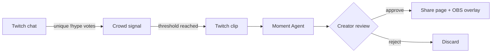
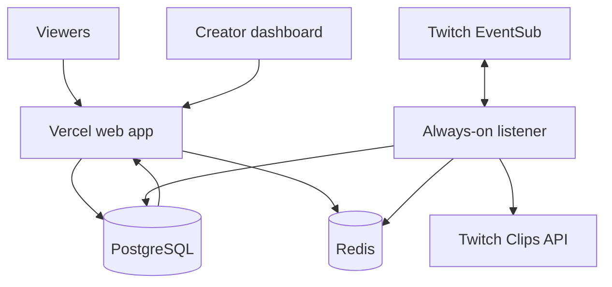

<p align="center">
  
</p>

<p align="center">
  <strong>The audience intelligence layer for live sports creators.</strong><br />
  Build anticipation before the stream, detect the moments that matter live, and let the creator approve what becomes history.
</p>

<p align="center">
  <a href="https://github.com/joboyebisi/CrowdPulseAI/actions/workflows/ci.yml"></a>
  
  
  
  
</p>

## Why CrowdPulse

Sports streams are not ordinary broadcasts. Excitement starts before kickoff, spikes unpredictably during play, and continues after the final whistle. CrowdPulse connects that whole arc:

| Before the stream | During the stream | After the moment |
| --- | --- | --- |
| Match lobby, countdown, fan predictions, polls, trivia, supporter check-ins | Real Twitch chat, unique `!hype` voting, moment detection, clip creation, OBS overlay | Creator review, grounded AI copy, share page, community recap |

> **Core principle:** the crowd provides the signal, AI assists with context, and the creator makes the final call.

## Current product loop



The working MVP includes:

- Twitch OAuth using the authorization-code flow
- `channel.chat.message` events over EventSub WebSockets
- Unique-viewer hype aggregation, sliding window, and cooldown
- Twitch Create Clip plus readiness polling
- Chat-grounded caption generation with a transparent fallback
- Gemini 3.8-powered Pundit and Growth Producer agents
- Distinct TikTok, YouTube Shorts, and X drafts for every candidate
- Optional spoken OBS commentary with `/overlay?voice=1`
- Creator approval and rejection
- Public moment pages and a transparent OBS browser source
- A sandbox rehearsal for setup checks; real Twitch is the primary workflow

## Next product frontier: Pre-Match Hype

CrowdPulse will give creators a shareable match lobby before they go live. Fans can check in, submit score predictions, answer a match poll or trivia prompt, and raise a visible community hype meter. At go-live, CrowdPulse turns those responses into the creator's opening talking points and carries the crowd state into the live overlay.

Read the [product positioning](docs/PRODUCT_POSITIONING.md), [demo runbook](docs/DEMO_RUNBOOK.md), [research brief](docs/research/prestream-engagement.md), [updated PRD](docs/hackathon-build/prd.md), and [product roadmap](docs/ROADMAP.md).

## Quick start

```bash
npm install
copy .env.example .env.local
npm run dev
```

Open `http://localhost:3000`. Use the sandbox rehearsal to verify the UI without credentials; the primary workflow connects to real Twitch OAuth, EventSub chat, and Clips. Follow the [Twitch setup guide](docs/TWITCH_SETUP.md).

## Commands

| Command | Purpose |
| --- | --- |
| `npm run dev` | Start local development |
| `npm run check` | Run TypeScript validation |
| `npm run lint` | Run ESLint |
| `npm test` | Run hype-detector tests |
| `npm run harness` | Replay Twitch-shaped chat fixtures through the complete agent pipeline |
| `npm run build` | Create a production build |
| `npm start` | Run the persistent Node.js server |

## Architecture

The web experience can run on Vercel, but the Twitch EventSub connection requires durable runtime state. The production design separates the web application from an always-on listener and stores sessions, moments, and crowd activity in shared infrastructure.



See [Architecture](docs/ARCHITECTURE.md) for runtime boundaries and deployment guidance.

## Agent harness

`npm run harness` replays a labelled `channel.chat.message` fixture through Signal Scout, Clip Director, Pundit, and Growth Producer using injected test adapters. It never calls Twitch or an AI provider. The dashboard's **Run sandbox rehearsal** action uses the same EventSub-shaped fixture and production orchestration code, while keeping the resulting moment visibly labelled as sandbox data.

Use `/api/health` to inspect non-secret readiness: configured providers, model selection, agent roster, and whether the current runtime can durably own the EventSub transport. A real end-to-end proof still requires a live Twitch channel with clips enabled and rotated production credentials.

## Product principles

- **Creator control:** no moment is published automatically.
- **Community signal:** duplicate votes never inflate hype.
- **Grounded AI:** no invented scores, teams, players, or match facts.
- **Clear provenance:** demo, AI-generated, and live Twitch data remain distinguishable.
- **Rights-aware:** CrowdPulse handles creator commentary and Twitch-authorised clips; it does not assume rights to sports footage.
- **Accessible participation:** core pre-match activities remain useful without gambling or Channel Points.

## Repository map

```text
src/app/                 Next.js routes and API handlers
src/components/          Landing, dashboard, and overlay UI
src/lib/                 Twitch, EventSub, session, hype, and AI logic
tests/                   Unit tests
docs/                    Product, architecture, setup, and research
.github/                 CI and contribution templates
```

## Contributing and security

Contributions are welcome through focused issues and pull requests. Start with [CONTRIBUTING.md](CONTRIBUTING.md). Report sensitive findings according to [SECURITY.md](SECURITY.md), not in a public issue.

---

<p align="center"><strong>Before kickoff. During chaos. After history.</strong></p>
