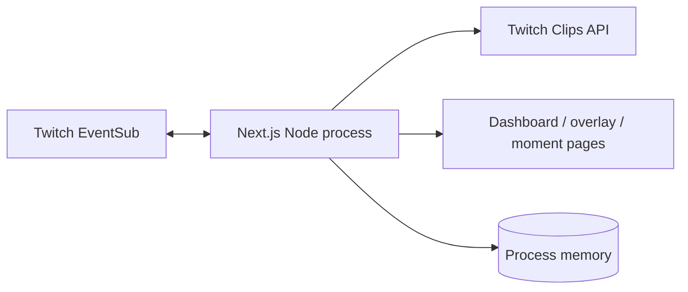
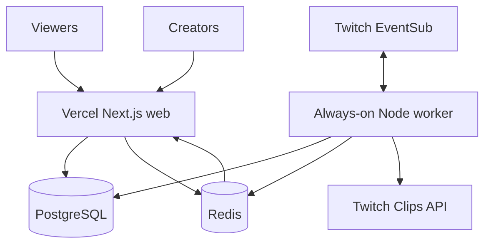

# Architecture

## Current MVP

The current Next.js process hosts the website, API routes, in-memory state, and Twitch EventSub WebSocket. This is excellent for local development and a persistent Node host, but it is not durable across serverless restarts.

## Production target

### Web application

- OAuth initiation and callback
- Creator dashboard and Match Room management
- Viewer participation and public moment pages
- OBS browser-source routes

### Always-on worker

- EventSub WebSocket lifecycle and subscription recovery
- Hype-window aggregation and cooldowns
- Clip creation and readiness polling
- Moment Agent jobs

### PostgreSQL

- Creators, encrypted Twitch grants, Match Rooms, prompts, responses, candidates, and approved moments

### Redis

- Unique participation sets, rate limits, live hype counters, listener leases, and dashboard updates

## Reliability boundaries

- Access tokens are encrypted at rest, refreshed on 401, and validated at startup and hourly.
- One listener lease exists per connected broadcaster.
- Every EventSub message and participation submission is idempotent.
- Public pages read durable state; they never depend on a warm function instance.
- AI failure produces a deterministic draft and never blocks clip review.

## Deployment recommendation

- **Vercel:** web application and request-driven APIs
- **Persistent Node host:** EventSub worker
- **Managed PostgreSQL and Redis:** shared durable state

The repository can also run as one persistent Node deployment until scale justifies separation.
