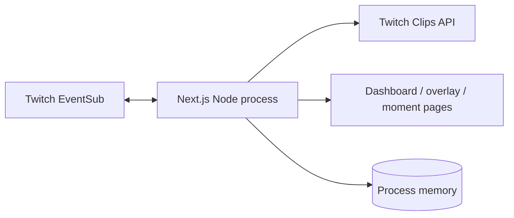
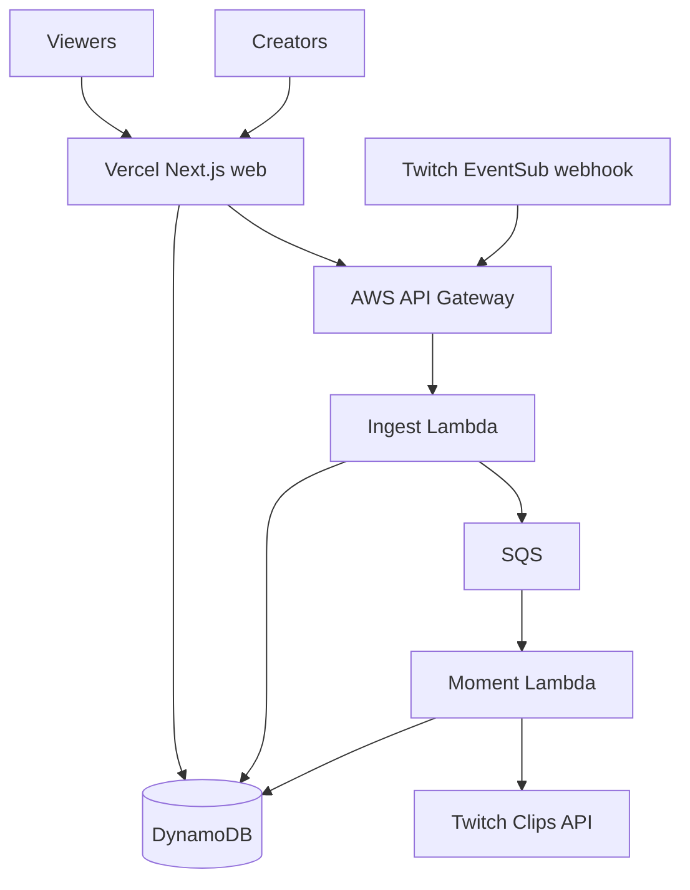

# Architecture

## Current MVP

The current Next.js process hosts the website, API routes, in-memory state, and Twitch EventSub WebSocket. This is excellent for local development and a persistent Node host, but it is not durable across serverless restarts.

## Production target

### Web application

- OAuth initiation and callback
- Creator dashboard and Match Room management
- Viewer participation and public moment pages
- OBS browser-source routes

### AWS event pipeline

- Signed EventSub webhook verification and replay protection
- SQS buffering and dead-letter handling
- Hype-window aggregation and cooldowns
- Clip creation and readiness polling
- Moment Agent jobs

### DynamoDB

- Creators, encrypted Twitch grants, Match Rooms, prompts, responses, chat events, candidates, and approved moments
- On-demand capacity, point-in-time recovery, encryption at rest, and TTL for ephemeral records

## Reliability boundaries

- Access tokens are encrypted at rest, refreshed on 401, and validated at startup and hourly.
- Every webhook is HMAC-verified, timestamp-checked, and deduplicated by Twitch message ID.
- Every EventSub message and participation submission is idempotent.
- Public pages read durable state; they never depend on a warm function instance.
- AI failure produces a deterministic draft and never blocks clip review.

## Deployment recommendation

- **Vercel:** web application and request-driven APIs
- **AWS API Gateway, Lambda, and SQS:** EventSub ingestion and moment jobs
- **AWS DynamoDB:** shared durable state
- **AWS Secrets Manager and KMS:** webhook and Twitch grant protection

The local WebSocket path remains useful for development and rehearsal while the webhook pipeline is completed.
